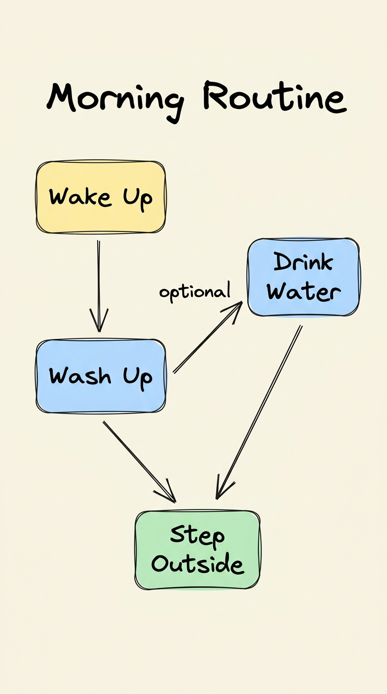
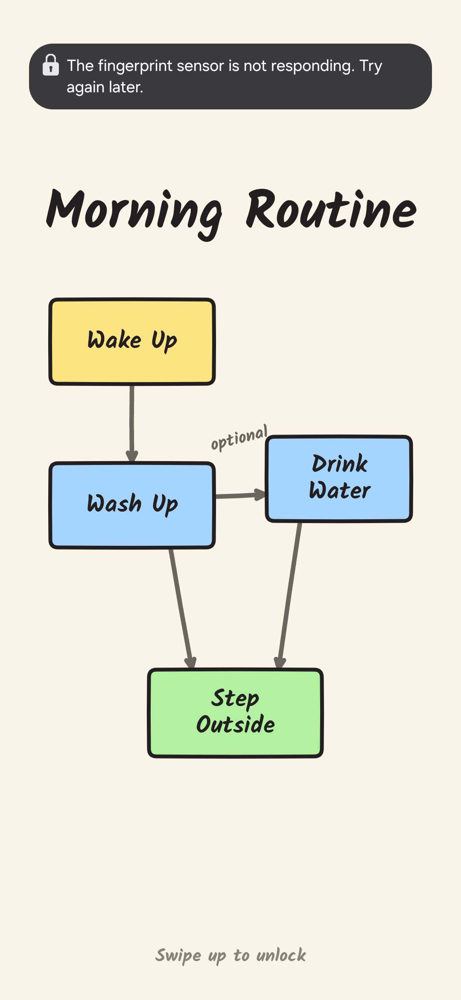
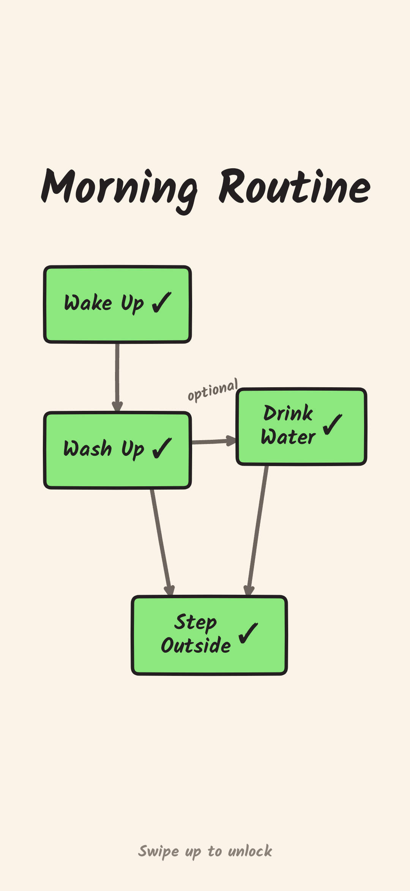

# Morning Routine — Official Showcase & Interactive Simulator

> An Excalidraw-style routine diagram that lives directly on your Android lockscreen. Wake your screen, hold to complete tasks, swipe up to unlock.

**[Try the Interactive Simulator Live](https://del0x3.github.io/morning-routine-site/)** &middot; **[Download Release APK (v1.1.1)](https://github.com/del0x3/morning-plan/releases/latest/download/app-release.apk)** &middot; **[Android Source Code](https://github.com/del0x3/morning-plan)**

---

## What is This?

Every morning, you check your phone for the time and get immediately hijacked by unread messages, social feeds, and notification badges.

**Morning Routine** fixes this at the operating system level:
- It replaces your system lockscreen clock with a calm, hand-drawn routine flowchart.
- No unlocking required. No apps to open. No distractions.
- Cards require a deliberate 650ms hold-to-confirm gesture so sleepy misclicks are ignored.
- Swipe up when you are done to seamlessly access your normal phone.

---

## Visual Comparison

| Gemini Concept Board | Clean Lockscreen (Device) | Completed Tasks (Device) |
| :---: | :---: | :---: |
|  |  |  |

---

## Live In-Browser Simulator

Before installing the APK on your phone, you can test the interaction directly on the website:

**[Open Live Simulator](https://del0x3.github.io/morning-routine-site/)**

- Click and **HOLD** down on any task card (`Wake Up`, `Wash Up`, `Drink Water`, `Step Outside`).
- Watch the fluid green fill animation snap into a checkmark (`✓`).
- Long-press any completed card to reset it.

---

## Get the App

The Android application is completely free, open-source, and offline (zero network permissions, zero telemetry).

- **Direct Download:** [app-release.apk (v1.1.1)](https://github.com/del0x3/morning-plan/releases/latest/download/app-release.apk)
- **Source Code & Issue Tracker:** [github.com/del0x3/morning-plan](https://github.com/del0x3/morning-plan)

---

## License

Released under the [MIT License](https://opensource.org/licenses/MIT).
